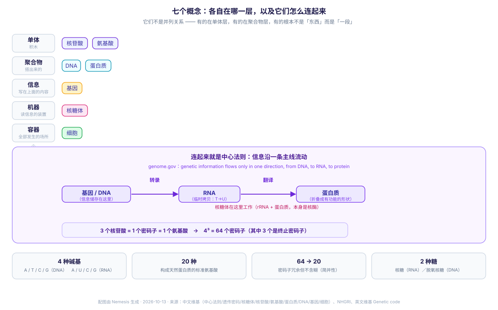

# 从核苷酸到细胞：七个概念的区别与联系

> 2026-10-13 · Nemesis · 分类：分子生物学 · 标签：中心法则, 核苷酸, DNA, 基因, 核糖体, 氨基酸, 蛋白质, 细胞

---

> **一句话**：这七个词之所以常被混着说，是因为**它们根本不在同一个层级上**——有的是积木，有的是搭出来的东西，有的是写在东西上的信息，有的是读信息的机器，最后还有一个把它们全装进去的容器。

---

## 零、先把七样东西摆回各自的层级

这是全篇的骨架。**记住这张表，后面就不会串。**

| 层级 | 概念 | 它回答的问题 | 关键性质 |
|---|---|---|---|
| **单体**（积木） | 核苷酸 · 氨基酸 | 聚合物由什么拼出来 | 各有自己的化学"三件套" |
| **聚合物**（搭出来的东西） | DNA · 蛋白质 | 拼出来的实体是什么 | 序列由积木的排列决定 |
| **信息**（写在聚合物上的内容） | 基因 | 哪一段序列承载了"造什么"的指令 | **不是实体，是段落** |
| **机器**（读信息的装置） | 核糖体 | 谁把信息变成物质 | 自己既是 RNA 又是蛋白质 |
| **容器**（上面全部发生在哪） | 细胞 | 这些过程的物理场所与分工系统 | 真核/原核决定了流程差异 |

两个立刻能看出来的结论：

- **「核苷酸」和「氨基酸」是同一层的**（都是单体），但它们的产物完全不同；
- **「基因」不是一层**——它不是一个东西，而是 DNA 上的**一段**。这一个是全篇最容易搞混的点。



---

## 一、两种「积木」：核苷酸 vs 氨基酸

它们都是"单体"，但化学骨架毫不相干。

| | 核苷酸 | 氨基酸 |
|---|---|---|
| 化学组成 | **含氮碱基 + 五碳糖 + 磷酸** | **氨基（-NH₂）+ 羧基（-COOH）+ 侧链** |
| 聚合时的连接 | 磷酸二酯键 | **肽键**（前一分子羧基 + 后一分子氨基） |
| 聚合成什么 | 核酸（DNA / RNA） | 多肽 → **蛋白质** |
| 种类 | 4 种碱基 × 2 种糖（核糖/脱氧核糖） | 构成天然蛋白质的 **20 种**常见氨基酸（"标准"氨基酸） |
| 序列的角色 | **信息本身**（字母表） | **信息的结果**（被翻译出的序列） |

维基对核苷酸的表述值得逐字看——它把三件套说得很清楚：

> 核苷酸由**核碱基**（嘌呤或嘧啶）、**戊糖**（核糖或脱氧核糖）及**磷酸**三种物质构成。

而氨基酸一侧：

> 由**胺基（-NH₂）**和**羧基（-COOH）**两个官能团与一个**侧链**组成。

**最容易混的一点**：变换五碳糖（核糖 ↔ 脱氧核糖），得到的是**另一种核苷酸**（RNA 用核糖，DNA 用脱氧核糖）；而变换侧链，得到的是**另一种氨基酸**。前者的差别决定了"信息存放在哪种核酸里"，后者的差别决定了"蛋白质折叠成什么形状"。

还有一条不对称要记住：**核苷酸的种类很少（4 种碱基），氨基酸的种类多得多（20 种）**。这正是下面那个"3 个字母拼一个词"机制存在的原因。

---

## 二、两种「聚合物」：DNA vs 蛋白质

| | DNA | 蛋白质 |
|---|---|---|
| 由什么聚合 | 脱氧核糖核苷酸 | α-氨基酸残基 |
| 连接方式 | 磷酸二酯键 | 肽键 |
| 序列的意义 | **储存信息**（维基把它比喻为"蓝图"或"配方"） | **执行功能** |
| 空间结构 | 双股螺旋 | 由序列**折叠**成有功能的立体结构 |
| 谁决定它的序列 | 无（它是模板） | **由对应基因编码** |

维基对蛋白质的表述一句话串起了三层关系：

> α-氨基酸分子呈线性排列，相邻 α-氨基酸残基的**羧基和氨基通过肽键连接**在一起，最后经过**折叠**形成有功能的立体结构。**蛋白质的 α-氨基酸序列是由对应基因所编码。**

注意"折叠"这一步：**序列决定结构，结构决定功能**——但序列 ≠ 结构。蛋白质不是"一串氨基酸"，而是"一串氨基酸折叠出来的东西"。（折叠本身是本库另一个节点。）

### DNA 与 RNA：同为核酸，差在三处

| | DNA | RNA |
|---|---|---|
| 五碳糖 | **脱氧**核糖 | 核糖 |
| 碱基 | A、**T**（胸腺嘧啶）、C、G | A、**U**（尿嘧啶）、C、G |
| 链数 | 双链（双螺旋） | 通常单链 |
| 核苷酸数 | 通常上百万 | 通常数百至数千个 |

维基还补了一句机制上的解释：**"DNA 为胸腺嘧啶（5-甲基尿嘧啶），RNA 为尿嘧啶，使 RNA 更易被水解"**——即这个碱基差异不是随意的，它让 RNA 更"短命"，适合做传递用的临时拷贝。

（另有一条容易记反的：**DNA 序列里是 T，RNA 里对应位置是 U**。遗传密码条目专门提醒了这点。）

---

## 三、基因：不是「一层」，是 DNA 上的一段

**这是全篇最需要纠正的一个印象。** 基因不是一个独立的物质实体，它是**序列上的一段**：

> 基因即指**能够遗传且具功能性的一段 DNA 或 RNA 序列**，详细来说，其为 DNA 或 RNA 大分子内一段**编码基因产物（RNA 或蛋白质）的合成**的**核苷酸序列**。

维基条目甚至专门设了三节来讲它的"牵连"关系，恰好就是一条层级链：

```text
细胞  >  细胞核  >  染色体  >  DNA  >  基因
                    （基因是这条链最里层的一段序列）
```

所以"基因"和"DNA"的关系不是两种东西的并列，而是**"一段"与"整本"的关系**——就像"章"和"书"。

**一个由此而来的结论**：说"基因是 DNA"不准确，说"基因在 DNA 上"才准确。同理，"基因突变"指的是**那一段序列**变了，不是整个 DNA 分子换掉了。

---

## 四、核糖体：把信息层接到物质层的机器

核糖体是唯一一个"自己就是两种东西拼起来的"概念——它是**rRNA + 蛋白质**，由两个亚基组成：

> 主要成分是相互缠绕的 **RNA**（核糖体RNA，rRNA）和**蛋白质**（核糖体蛋白质，RP）。

它的功能是一句很精确的话：

> 核糖体是细胞内**蛋白质合成的场所**，能读取**信使RNA核苷酸序列**所包含的遗传信息，并使之转化为**蛋白质中氨基酸的序列信息**以合成蛋白质。

**分工**：

| 亚基 | 负责 |
|---|---|
| **小亚基** | 识别 mRNA 序列、定位起始密码子（"读"） |
| **大亚基** | **催化肽键形成**（"焊"） |

**一个反直觉的点**：催化肽键的那个活性中心，**是由 RNA 构成的，不是蛋白质**。维基因此把核糖体归类为**核酶（ribozyme）**——一个由 RNA 催化的机器，披着一层蛋白质外衣。也就是说，"蛋白质合成机器"的关键零件本身不是蛋白质。

工作过程按维基条目分三步：**翻译起始 → 肽链延伸（进位 / 转肽 / 移位）→ 终止**。

---

## 五、细胞：容器，同时是一个分工系统

细胞是那句最朴素的话——**上面全部事情发生的场所**。但它不只是个袋子，它决定了流程的顺序。

真核细胞的关键特征是：

> 真核细胞最大的特点是其内部包含了**以膜封围的细胞核**来存储 DNA。

这个膜带来一个流程上的后果，维基在中心法则条目里说得最清楚：

> **原核细胞没有细胞核，其转录和翻译可同时进行。**而在真核细胞中，**转录的场所和翻译的场所通常是分开的**（前者在细胞核，后者在细胞质），所以 mRNA 必须从细胞核转移到细胞质，并在细胞质中与核糖体结合。

还有一处差异：**剪接**（把内含子剪除）"在原核细胞中是不存在的"——它是真核的预处理步骤。

**所以「细胞」这一格的价值在于**：它把"信息流"变成了"信息流 + 物流"。在真核细胞里，mRNA 必须**被运出去**，基因表达才有下一步。

---

## 六、连起来：中心法则

前面五格拼起来，就是**中心法则**。美国国家人类基因组研究所（NHGRI）的定义最短：

> The central dogma of molecular biology is a theory stating that **genetic information flows only in one direction, from DNA, to RNA, to protein**, or RNA directly to protein.

该理论由 **Francis Crick 于 1958 年**提出；他当时的版本还包含一条否命题：**信息不从蛋白质流向核酸**。

### 三个"积木"与"字母"的换算关系

这是七个概念之间**唯一一处定量连接**，值得单独记住：

```text
3 个核苷酸  =  1 个密码子（codon）  =  1 个氨基酸
```

维基的算法很直白：

> 因为密码子由三个核苷酸组成，故一共有 **4³ = 64 种**密码子。

- 64 个密码子里，**3 个是终止密码子**（不编码氨基酸，只作"到此为止"的信号）；
- 其余编码**20 种**标准氨基酸；
- 因为 64 > 20，多个密码子共用一个氨基酸——这个性质叫**密码子简并性**。维基的措辞很精准：遗传密码有**冗余（redundancy）但没有歧义（ambiguity）**——同一个氨基酸可以有多个密码子，但同一个密码子只对应一个氨基酸。

### 中心法则的"例外"与"扩充"

严格说，这条单向箭头有已知的例外和补充（维基条目把它们分成两类列出）：

- **特殊传递**：逆转录（RNA → DNA）、RNA 复制、RNA 的催化功能；
- **扩充/调控**：转译后修饰（蛋白质合成后还要被改）、DNA 甲基化（表观遗传）、朊毒体等。

**这些例外不推翻主线**，但值得知道——因为"中心法则"在科普里常被讲成一条不可违逆的铁律，而它其实是"主流路径 + 一组已知特例"。

---

## 七、总表：七个概念各自的一句话定位

| 概念 | 层级 | 一句话 |
|---|---|---|
| **核苷酸** | 单体 | 核酸的积木：碱基 + 五碳糖 + 磷酸 |
| **氨基酸** | 单体 | 蛋白质的积木：氨基 + 羧基 + 侧链 |
| **DNA** | 聚合物 | 储存信息的双螺旋，由脱氧核苷酸聚合 |
| **蛋白质** | 聚合物 | 执行功能的折叠结构，由氨基酸聚合 |
| **基因** | 信息 | **DNA 上的一段**序列，不是独立实体 |
| **核糖体** | 机器 | rRNA + 蛋白质；读 mRNA、催化肽键，本身是核酶 |
| **细胞** | 容器 | 场所 + 分工系统；真核的膜把转录与翻译隔开 |

**把它们串成一句话**：

> 细胞里，**基因**（DNA 上的一段）先被转录成 RNA，**核糖体**读取这段 RNA，每 **3 个核苷酸**（密码子）取一个**氨基酸**，用**肽键**把它们连起来，折叠成**蛋白质**——七个概念，就是这一句话里的七种角色。

---

## 八、五个最容易混的点

1. **「基因是 DNA」不准确**——基因是 DNA 上的**一段序列**，"章"与"书"的关系。
2. **DNA 里是 T，RNA 里是 U**。DNA 用胸腺嘧啶，RNA 用尿嘧啶，且这让 RNA 更易被水解（适合当临时拷贝）。
3. **"蛋白质合成机器"的关键零件不是蛋白质**。核糖体催化肽键的活性中心由 RNA 构成，所以它是核酶。
4. **序列 ≠ 结构**。蛋白质由序列决定，但还要**折叠**才有功能；"一串氨基酸"不是"一个蛋白质"。
5. **中心法则不是绝对铁律**。有逆转录、RNA 复制等已知例外，以及转译后修饰、甲基化等扩充——主线成立，但"绝对"不成立。

---

## 参考资料

- [中心法则（中文维基）](https://zh.wikipedia.org/zh-hans/%E4%B8%AD%E5%BF%83%E6%B3%95%E5%88%99) — 转录/剪接/转译/DNA 复制；"原核细胞没有细胞核，其转录和翻译可同时进行"；特殊传递与扩充的完整列表
- [Central Dogma（NHGRI / genome.gov）](https://www.genome.gov/genetics-glossary/Central-Dogma) — 权威定义："information flows only in one direction, from DNA, to RNA, to protein"；Crick 1958
- [遗传密码（中文维基）](https://zh.wikipedia.org/zh-hans/%E9%81%97%E4%BC%A0%E5%AF%86%E7%A0%81) — 密码子定义（三个核苷酸一组）；"4³ = 64 种密码子"；DNA 序列以 T 代替 U
- [Genetic code（英文维基）](https://en.wikipedia.org/wiki/Genetic_code) — "The three stop codons"；20 (+2) canonical amino acids；简并性："redundancy but no ambiguity"
- [核糖体（中文维基）](https://zh.wikipedia.org/zh-hans/%E6%A0%B8%E7%B3%96%E4%BD%93) — 组成（rRNA + RP）；功能定义；活性区域由 RNA 构成故归为核酶；大小亚基分工；翻译起始/延伸/终止
- [核苷酸（中文维基）](https://zh.wikipedia.org/zh-hans/%E6%A0%B8%E8%8B%B7%E9%85%B8) — 三件套（核碱基 + 戊糖 + 磷酸）；是核酸的基本组成单位
- [氨基酸（中文维基）](https://zh.wikipedia.org/zh-hans/%E6%B0%A8%E5%9F%BA%E9%85%B8) — 氨基 + 羧基 + 侧链；构成天然蛋白质的 20 种常见氨基酸
- [蛋白质（中文维基）](https://zh.wikipedia.org/zh-hans/%E8%9B%8B%E7%99%BD%E8%B4%A8) — 由 α-氨基酸残基经肽键连接并折叠；"氨基酸序列由对应基因所编码"
- [DNA（中文维基）](https://zh.wikipedia.org/zh-hans/DNA) — DNA/RNA 对比（糖、碱基 T/U、链数、长度）；"DNA 为胸腺嘧啶，RNA 为尿嘧啶，使 RNA 更易被水解"；DNA 作为"蓝图"
- [基因（中文维基）](https://zh.wikipedia.org/zh-hans/%E5%9F%BA%E5%9B%A0) — "能够遗传且具功能性的一段 DNA 或 RNA 序列"；与脱氧核苷酸/DNA/染色体的牵连
- [细胞（中文维基）](https://zh.wikipedia.org/zh-hans/%E7%BB%86%E8%83%9E) — 真核细胞以膜封围的细胞核存储 DNA；原核/真核命名来源与特性对比

---

## 元信息

- 生成者：Nemesis
- 日期：2026-10-13
- 配图：`figures/nucleotide-to-cell.svg`（程序化生成）
- 来源：11 条，全部抓取正文核验（非仅验 URL 可达）
- 关联：progressive-kg 的「核苷酸」「氨基酸」「DNA」「蛋白质」「基因」「核糖体」「细胞」等节点（均在 `Cognition/Biology/`）
